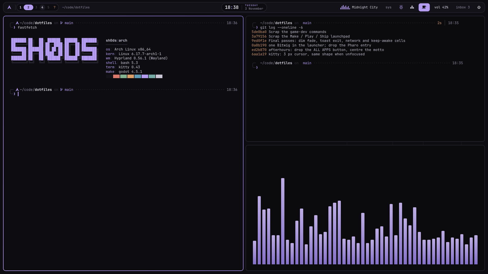
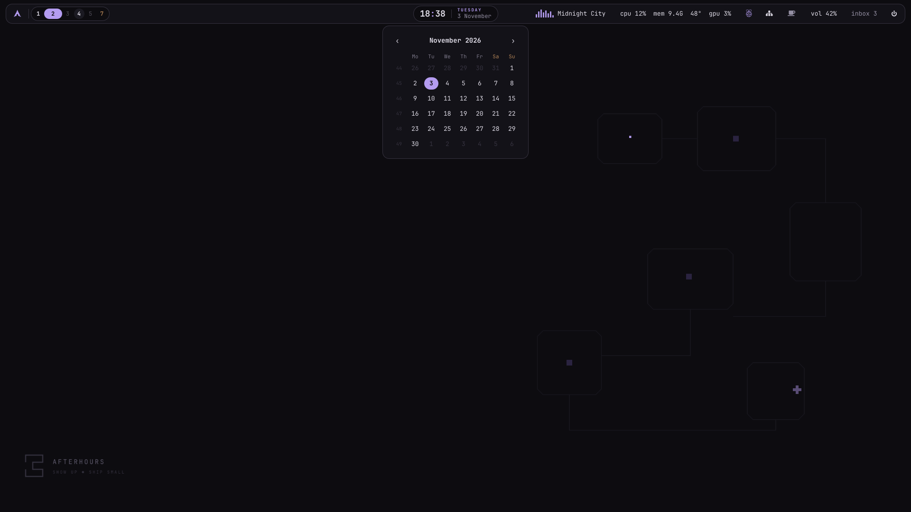

# Afterhours

My Arch + Hyprland desktop for making small games. Near-black charcoal with violet accents, one font (JetBrains Mono Nerd Font), notched corners (cut at 45°, never rounded) and calm motion. The bar, launcher, lock screen, notifications and everything else on screen are my own Quickshell config, not a preset.





## Description

- **The rail** is three frosted glass pieces with notched corners on every monitor: apps, workspaces and the focused window's title on the left, the island in the middle, and on the right now playing with cava bars, a keep-awake toggle, the Pi, network and sound side by side, the tray, the inbox and the power menu. Hover anything for a hint. The wheel changes the volume on `vol` and skips tracks on now playing, and right-click on `vol` mutes.
- **The island** in the middle is the clock. It stretches into the volume bar when you change the volume, into the notification when one lands (click to open it, right-click to dismiss), and into the song when a new track starts, then shrinks back to the time.
- **Today** opens from the clock: the month, cpu / gpu / memory graphs, the disks, the Pi with its ping, and now playing.
- **Everything moves on one spring:** popups grow out of what you clicked, launcher rows cascade in, the overview zooms out of the workspace you're on, the workspace marker stretches like a drop, and windows bloom open with a small bounce.
- **One launcher** for everything: type to find an app, or start with `=` for maths, `>` for commands, `/` for open windows and `:` for emoji.
- **The overview** (`Super + W`) shows every workspace with live previews of its windows. Click one to go there, drag it to another workspace, middle-click to close it.
- **The media card** opens from now playing: the cover, a seek bar, shuffle, loop and bigger cava bars.
- **The control centre** opens from `vol` or the network icon: outputs, the mic, a volume per app, Wi-Fi networks and toggles for night light, quiet, keep awake and game mode.
- **A thin frame** runs round the screen edge and joins the rail, so the desktop reads as one piece.
- **See-through windows:** every window lets the wallpaper show through, blurred, a little more when it isn't focused. kitty keeps its text solid over a see-through background; games, video, art tools and fullscreen stay solid.
- **The wallpaper** is the haze with soft violet clouds over it. It never moves.
- **My own lock screen** with a big clock, the password field and what is playing. hyprlock is still there as the fallback.
- **Game mode** turns on by itself when a game goes fullscreen: the rail and frame hide on the game's monitor (the other monitor keeps its rail), and animations, dimming and shadows go off while you're on the game's monitor. You can also flip it in the control centre.
- **Notifications** and the **volume** come from the shell itself: they show in the island on the monitor you're on (as toasts and a volume panel while the rail is hidden), with a quiet mode and an inbox for the session. Screen sharing hides them.
- **Everything from boot to desktop matches:** the Plymouth splash, the SDDM login, the lock screen and the wallpaper.
- **kitty** has a violet 3 px beam cursor with a short trail, and a two-line starship prompt.
- **Thunar, Firefox, Obsidian and Zed** use the same palette, with Papirus icons (violet folders) and the Posy cursor.
- Unfocused windows dim a little. Games, video and picture-in-picture never do.
- Wrappers for my game tools: `pico8`, `picotron`, `aseprite`, `bitwig` and `sfx` (jsfxr / ChipTone), and `gba` for Game Boy games in mGBA, with every game in `~/games/roms/gba` in the launcher. PICO-8 and Picotron are paid downloads from Lexaloffle, so they're not in here.
- `battlenet` for World of Warcraft: Battle.net under Proton (umu-launcher with GE-Proton) in its own prefix, `~/games/battlenet`, next to the roms in `~/games`. The first start installs it. It lives on workspace 5 with the games, and WoW opens fullscreen with GameMode and game mode like a Steam game. Its pop-ups never take the focus. `curseforge` runs the CurseForge app for the addons, pointed at WoW Forever's folder in that prefix.
- PICO-8 and Picotron code in Zed: their APIs in the Lua language server, `F5` reruns the cart in the console, `F7` counts PICO-8 tokens. How it works is in [docs/gamedev.md](docs/gamedev.md#code-in-zed-everything-else-in-the-console).
- Plus the DJ VM, clipboard history, OCR, screen recording and captioned devlog screenshots.

## Getting Started

You need Arch, Hyprland 0.56 (the Lua config) and Quickshell 0.3.2 or newer. The full package list is in [docs/desktop-rebuild.md](docs/desktop-rebuild.md). Coming from my old Diag setup? Use [docs/install-from-diag.md](docs/install-from-diag.md).

```sh
git clone https://github.com/sh0ds/dotfiles ~/code/dotfiles
cd ~/code/dotfiles
bash install-dotfiles.sh        # links the configs, backs up old ones to ~/.dotfiles-backup
bash system/install-system.sh   # login screen, boot splash, violet folders (needs sudo)
```

Then log out and pick Hyprland. The main monitor is set in `.config/hypr/hyprland.lua` (mine is DP-4). The keyboard is German with Caps Lock as Escape.

Run `bash install-dotfiles.sh` again whenever files get added or removed. It cleans up dead links.

## Keys

- `Super + Return` terminal, `Super + Space` launcher, `Super + W` overview, `Super + B` Firefox, `Super + E` files, `Super + O` notes
- `Super + N` inbox, `Super + Shift + Escape` power menu, `Super + Escape` lock
- `Super + 1…0` workspace, `Super + Shift + 1…0` move the window there
- `Super + arrows` or `h j k l` focus, add `Shift` to move the window
- `Super + V` float and centre, `Super + F` fullscreen, `Super + G` group, `Super + Q` close
- `Super + C` maths, `Super + Shift + V` clipboard, `Super + period` emoji, `Alt + Tab` windows, `Super + D` docs
- `Print` region to clipboard, `Ctrl + Print` draw on it, `Alt + Print` captioned devlog shot
- `Super + Shift + R` record a region, `Super + Shift + B` hide the rail, `Super + Shift + M` DJ VM
- `Super + F1` lists all of them (from [docs/keys.md](docs/keys.md))

## Help

```sh
afterhours restart       # restart the shell
afterhours debug         # run it in the foreground and see errors
afterhours quiet true    # no toasts, the inbox still collects
bash check-desktop.sh    # checks the installed session
python3 -m unittest discover -s tests
```

The old Diag setup and its screenshots are in [docs/legacy-desktop.md](docs/legacy-desktop.md).

## License

MIT. A few app themes started as Catppuccin ports and keep their notices. The shell and wallpaper are mine.
