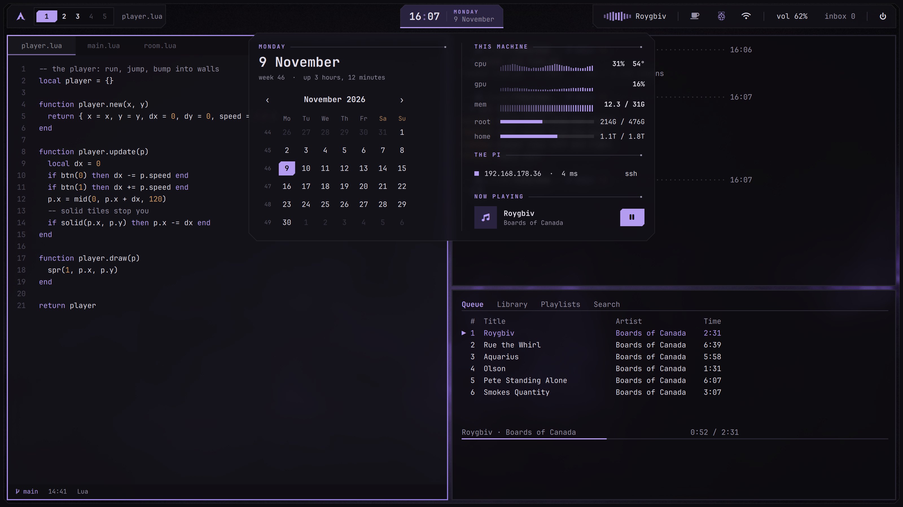
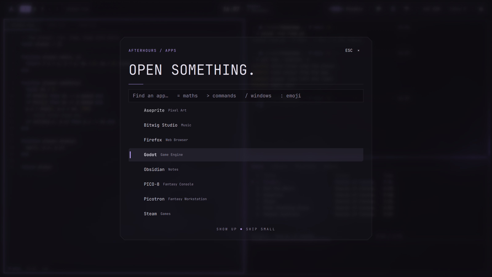
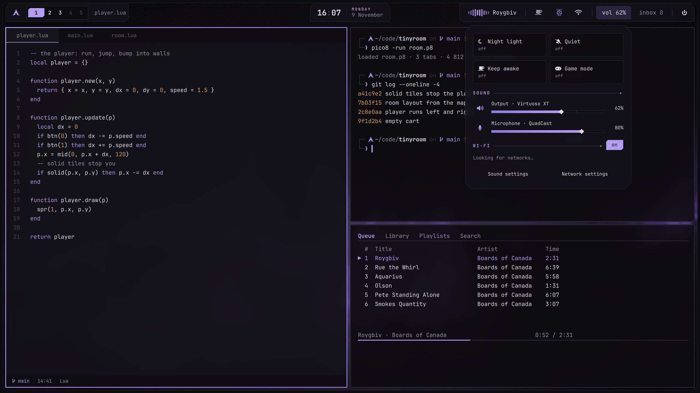
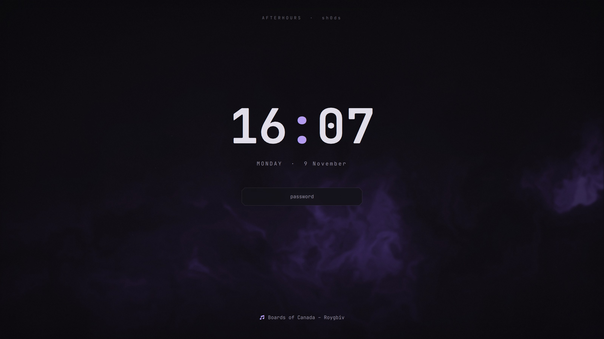
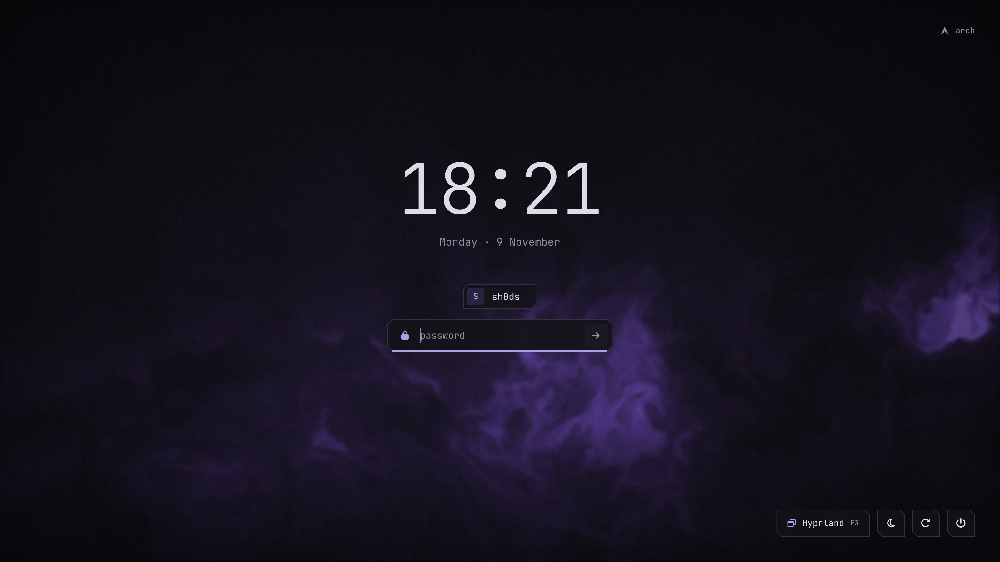

# Afterhours

My Arch + Hyprland desktop for making small games (and playing some, and music). Almost black with violet accents, one font everywhere (JetBrains Mono Nerd Font), notched corners and calm motion. The bar, launcher, lock screen, notifications and pretty much everything else on screen is my own Quickshell config, not a preset.




## Description

Nothing is rounded. Everything that floats cuts its corners at 45 degrees instead, buttons cut two opposite corners (mirrored on the right side of the rail), and windows, lists and cards stay square. Violet shows that something is on, as a fill or a thin underline but never as an outline.

What's in it:

- **The rail:** three frosted glass pieces on every monitor. Apps, workspaces and the focused window on the left, the island in the middle, and on the right now playing with cava bars, keep awake, the Pi, network, sound, the tray, the inbox and the power menu. Hover anything for a hint. Scrolling on `vol` changes the volume, on now playing it skips tracks, and right-click on `vol` mutes.
- **The island** is the clock. It turns into the volume bar when you change the volume and into a notification when one comes in (click to open, right-click to dismiss), then shrinks back to the time. New songs don't pop up there, now playing on the right has them.
- **Today** opens from the clock: the month, cpu, gpu and memory graphs, the disks, the Pi with its ping and what's playing.
- **One spring for everything:** popups grow out of what you clicked, launcher rows cascade in, the overview zooms out of your workspace, the workspace marker stretches like a drop and windows open with a small bounce.
- **One launcher:** type to find an app, or start with `=` for maths, `>` for commands, `/` for open windows and `:` for emoji.
- **The overview** (`Super + W`) shows every workspace with live previews. Click to go there, drag a window to another workspace, middle-click to close it.
- **The media card** opens from now playing with the cover, a seek bar, shuffle, loop and bigger cava bars.
- **The control centre** opens from `vol` or the network icon: outputs, the mic, volume per app, Wi-Fi and toggles for night light, quiet, keep awake and game mode.
- **A thin frame** runs around the screen edge and joins the rail, so it all looks like one piece.
- **See-through windows:** the blurred wallpaper shows through every window, a bit more when it's not focused. kitty keeps its text solid, and games, video, art tools and fullscreen stay solid too. Unfocused windows dim a little, except games, video and picture-in-picture.
- **The wallpaper** is a haze with soft violet clouds. It never moves.
- **My own lock screen** with a big clock, the password field and what's playing. hyprlock is still there as a fallback.
- **Game mode** turns on by itself when a game goes fullscreen. The rail and frame hide on that monitor (the other one keeps its rail), and animations, dimming and shadows turn off while you're on it. You can also flip it in the control centre.
- **Notifications and volume** come from the shell itself and show in the island on the monitor you're on, as toasts and a volume panel while the rail is hidden. There's a quiet mode and an inbox, and a line at the bottom of each toast runs out so you see how long it stays. Screen sharing hides them.
- **Boot to desktop matches:** the Plymouth splash, the SDDM login, the lock screen and the wallpaper.
- **kitty** has a 3 px violet beam cursor with a short trail and a two-line starship prompt. **Thunar, Firefox, Obsidian and Zed** use the same colours, with Papirus icons (violet folders) and the Posy cursor.
- **Game tools:** wrappers for `pico8`, `picotron`, `aseprite`, `bitwig` and `sfx` (jsfxr / ChipTone), and `gba` for Game Boy games in mGBA, with every game in `~/games/roms/gba` in the launcher. PICO-8 and Picotron are paid downloads from Lexaloffle, so they're not in here.
- **WoW:** `battlenet` runs Battle.net under Proton (umu-launcher with GE-Proton) in its own prefix, `~/games/battlenet`, and the first start installs it. It lives on workspace 5 with the games, WoW opens fullscreen with GameMode and game mode like a Steam game, and its pop-ups never steal focus. `curseforge` runs the CurseForge app for addons, pointed at WoW Forever's folder in that prefix.
- **PICO-8 and Picotron in Zed:** their APIs in the Lua language server, `F5` reruns the cart, `F7` counts PICO-8 tokens. How that works is in [docs/gamedev.md](docs/gamedev.md#code-in-zed-everything-else-in-the-console).
- Plus the DJ VM, clipboard history, OCR, screen recording and captioned devlog screenshots.

## More screenshots









These are rendered from the shell's own QML in this repo, so the app windows in them are just stand-ins.

## Getting Started

You need Arch, Hyprland 0.56 or newer (the Lua config) and Quickshell 0.3.2 or newer. The full package list is in [docs/desktop-rebuild.md](docs/desktop-rebuild.md).

```sh
git clone https://github.com/sh0ds/dotfiles ~/code/dotfiles
cd ~/code/dotfiles
bash install-dotfiles.sh        # links the configs, backs up old ones to ~/.dotfiles-backup
bash system/install-system.sh   # login screen, boot splash, violet folders (needs sudo)
```

Then log out and pick Hyprland. Keep in mind it's set up for my machine: the main monitor is set in `.config/hypr/hyprland.lua` (mine is DP-4), and the keyboard is German with Caps Lock as Escape.

Run `bash install-dotfiles.sh` again whenever files get added or removed, it cleans up dead links too.

## Keys

- `Super + Return` terminal, `Super + Space` launcher, `Super + W` overview, `Super + B` Firefox, `Super + E` files, `Super + O` notes
- `Super + N` inbox, `Super + Shift + Escape` power menu, `Super + Escape` lock
- `Super + 1…0` workspace, `Super + Shift + 1…0` move the window there
- `Super + arrows` or `h j k l` focus, add `Shift` to move the window
- `Super + V` float and centre, `Super + F` fullscreen, `Super + G` group, `Super + Q` close
- `Super + C` maths, `Super + Shift + V` clipboard, `Super + period` emoji, `Alt + Tab` windows, `Super + D` docs
- `Print` region to clipboard, `Ctrl + Print` draw on it, `Alt + Print` captioned devlog shot
- `Super + Shift + R` record a region, `Super + Shift + B` hide the rail, `Super + Shift + M` DJ VM
- `Super + F1` lists all of them (from [docs/keys.md](docs/keys.md))

## Help

```sh
afterhours restart       # restart the shell
afterhours debug         # run it in the foreground and see errors
afterhours quiet true    # no toasts, the inbox still collects
bash check-desktop.sh    # checks the installed session
python3 -m unittest discover -s tests
```

My old Diag setup and its screenshots are still in [docs/legacy-desktop.md](docs/legacy-desktop.md).

## License

MIT. A few app themes started as Catppuccin ports and keep their notices. The shell and wallpaper are mine.
