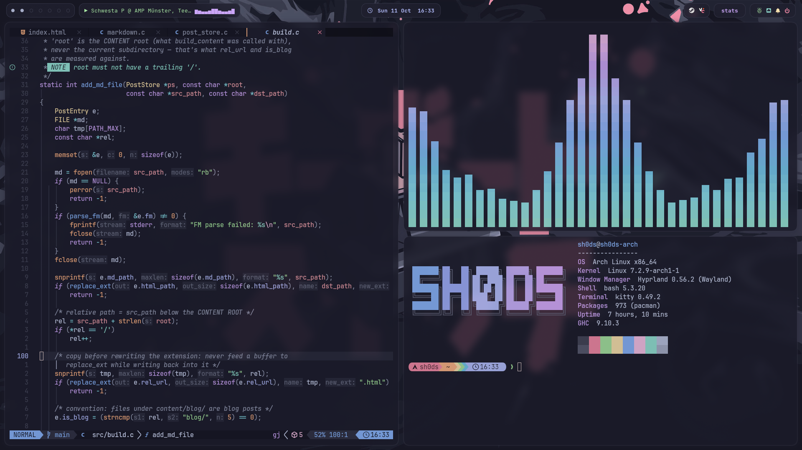
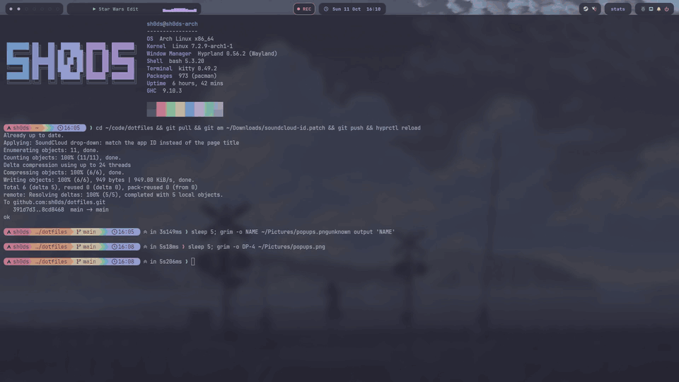
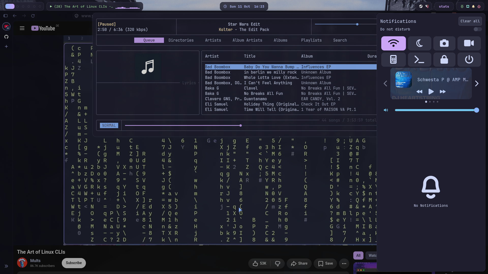
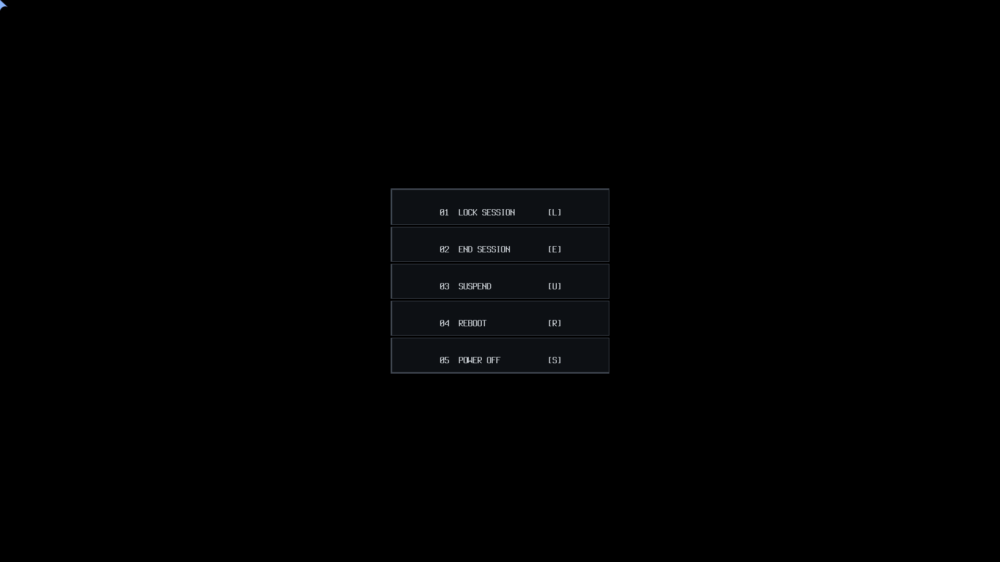
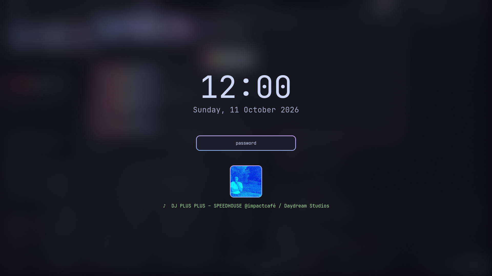

# dotfiles

My Arch + Hyprland setup, themed in Catppuccin Mocha.





## Description

The configs I use on my desktop. It runs Hyprland 0.56 with the new Lua config. `hyprland.lua` is the base config and `rice.lua` has all the theming, animations, window rules and extra keybinds on top of it. If something in `rice.lua` breaks, the base config keeps working.

### Look

Only the focused window gets the blue-to-mauve border and a soft glow, the rest are slightly dimmed. If there's just one window on a workspace it fills the whole screen without gaps. Windows open with a small pop and settle into place. Bars, menus and notifications sit on frosted glass, and every app I could find a Catppuccin theme for uses it, GTK and Qt apps included, so nothing flashes white.

### Pop-ups

The things I need for a few seconds and then want gone slide down from the top of the screen, one at a time, and slide back up when I press the key again:

- `SUPER+Z` terminal, `SUPER+O` notes (`~/notes/inbox.md`)
- `SUPER+S` SoundCloud (a web app through [PWAsForFirefox](https://github.com/filips123/PWAsForFirefox)), `SUPER+U` my own music (rmpc)
- `SUPER+I` WhatsApp (in the terminal with [nchat](https://github.com/d99kris/nchat))
- `CTRL+SHIFT+Escape` btop, same key as the task manager on Windows

### Bar

waybar with three parts:

- **Left:** workspace dots and the current song or video (click to pause, scroll to skip)
- **Middle:** the clock (hover for a calendar), plus a red LIVE pill when I'm sharing my screen and REC when I'm recording
- **Right:** tray, a "stats" pill (hover for CPU, temperature, RAM, GPU and disk, click for btop), and one pill for my Raspberry Pi (green when it's online), volume, network (click for a Wi-Fi menu), notifications and a power button

### Everything else

Desktop:

- **swaync** for notifications, `SUPER+N` opens the panel. **swayosd** shows a little pill when you change the volume.
- **hyprlock** is the lock screen, with the cover and title of whatever is playing. **hypridle** locks after 10 minutes, turns the screens off after 11 and suspends after an hour.
- **wlogout** is the power menu (lock, log out, suspend, reboot, shut down).
- **awww** for wallpapers. `SUPER+W` grows a random one from `~/Pictures/walls` out of the mouse.
- **fuzzel** as the launcher. It also runs the calculator, emoji picker, docs search, clipboard history, window switcher and Wi-Fi menu.
- **udiskie** mounts USB sticks as soon as you plug them in. Click Browse in the notification to open it, `SUPER+SHIFT+U` unmounts them all.

Terminal:

- **kitty + tmux**. kitty has a cursor trail and sends a notification when a long command finishes while you're looking elsewhere. The tmux prefix is `Ctrl+A`.
- **bash** with [starship](https://starship.rs), eza instead of ls, fzf on `Ctrl+R` and zoxide (`z`). New terminals greet you with fastfetch.
- **Neovim** with LazyVim, on the same see-through background as the terminal. My cheat sheet for it is in [docs/neovim.md](docs/neovim.md).
- **yazi** for files (`SUPER+E`, or `y` and the shell follows you to wherever you quit it), **lazygit** (`lg`), **bat** instead of cat and **tldr** for short examples instead of man pages.

Apps:

- **mpd + rmpc** for my own music in `~/Music`. The bar, the media keys and the lock screen pick it up just like SoundCloud.
- **mpv, imv and zathura** for videos, pictures and PDFs. Opened from a terminal they take its place until you close them.
- **Audacity** for recording audio. It opens on workspace 4 and keeps the screen awake while it's open.
- **Bitwig Studio** for making speedhouse, on workspace 6. Synth and effect windows float on top of the arrangement.
- **beets** for my DJ library, through the `dj` script. `dj add` works out a track's BPM and key and writes them into the file, `dj genre:speedhouse` or `dj bpm:150..160` lists matching tracks by BPM, and crates (speedhouse, new this month, one per key) show up as playlists in rmpc.
- **Proton Pass** for passwords, floating in the middle on `SUPER+SHIFT+P`.
- **Old School RuneScape** in [RuneLite](https://runelite.net), started from the [Bolt](https://bolt.adamcake.com) launcher so Jagex accounts work on Linux. `SUPER+R` opens it, or jumps back to it if it's already running. The screen stays awake while it has focus, and RuneLite's idle notifications show up like any other. My RuneLite profile (see Installing) brings the plugins, the Mocha colours and a Mocha skin for the game's interface that I made from the original one.
- **Steam** and every game go on workspace 5. Games get GameMode on their own, adaptive sync, no vsync for lower input lag, and quiet notifications until you quit.

Keeping Arch healthy:

- A notification shows up when 20 or more updates are waiting, with a button that runs the update (AUR packages included). It tells you when one needs a reboot too.
- snapper takes a snapshot before and after every update, so a broken one can be rolled back. Weekly timers clear out old packages, trim the SSD and refresh the mirror list.

### Scripts

Small scripts in `.local/bin` I wrote for things I kept needing. Each one has a short comment at the top explaining what it does.

- `scratch`: the drop-down logic behind `dropterm`, `quicknote`, `chat`, `music` and `sysmon`
- `wifi`: pick a Wi-Fi network in fuzzel (it asks for the password on new ones), right-click the icon for nmtui
- `winswitch`: ALT+Tab through all windows, most recent first
- `calc`: calculator, try `2^10`, `15% of 89` or `300 EUR to USD`
- `emoji`: the emoji you pick gets typed and copied
- `docs`: `h` for Hoogle, `p` for Hackage, `w` for the Arch Wiki, `m` for man pages, anything else goes to DuckDuckGo
- `site-dev`: my tmux session for working on sh0ds.dev, with windows for the editor, builds, a REPL and the Pi. The Pharo IDE (`~/pharo`, for the site's `site` command) is "Pharo" in the launcher
- `ocr`: drag a box around any text on screen and it's copied to your clipboard
- `rec-toggle`: record a part of the screen to `~/Videos`
- `share-picker`: a faster screen-share picker, since the default one kept freezing with Discord
- `live-status`: do-not-disturb while I share my screen, so nothing private pops up on stream
- `chat-notify`: WhatsApp messages as notifications, click one and WhatsApp slides in
- `keys`: every keybind from the table below in a searchable list (`SUPER+F1`)
- `app`: jumps to an app if it's open, otherwise starts it (Audacity, Bitwig)
- `dj`: my DJ library, see the beets line above
- `osrs`: focuses RuneLite if it's open, otherwise starts Bolt
- `runelite-skin`: builds the Mocha skin for OSRS from the RuneLITE resource pack
- `update-check`, `default-apps`, `wall-next`, `nightlight`, and the helpers behind the bar and the lock screen (`gpu-status`, `pi-status`, `rec-status`, `np-title`, `np-art`)

## Screenshots

The music player and the notification panel:



The power menu:



The lock screen:



## Getting Started

### Dependencies

Arch with Hyprland 0.56 or newer (the Lua config doesn't work on older versions) and the multilib repo turned on for Steam. Then these packages:

```
sudo pacman -S --needed hyprland hyprlock hypridle hyprsunset hyprpicker xdg-desktop-portal-hyprland \
  xdg-desktop-portal-gtk hyprpolkitagent waybar swaync swayosd awww fuzzel kitty tmux neovim \
  starship eza fzf zoxide fastfetch sl ttf-jetbrains-mono-nerd noto-fonts-emoji \
  grim slurp satty wl-clipboard cliphist wf-recorder wtype playerctl pavucontrol pipewire-alsa jq socat \
  libqalculate tesseract tesseract-data-eng libnotify unicode-emoji udiskie \
  yazi fd ripgrep poppler ffmpeg 7zip imagemagick btop lazygit bat tealdeer \
  mpd rmpc mpd-mpris mpv imv zathura zathura-pdf-mupdf audacity realtime-privileges python-pipx firefox \
  ufw adw-gtk-theme qt6ct gamemode lib32-gamemode pacman-contrib reflector jre17-openjdk python-pillow
yay -S wlogout catppuccin-cursors-mocha nchat proton-pass-bin bolt-launcher bitwig-studio keyfinder-cli
```

### Installing

Clone the repo and run the install script. It symlinks everything into your home folder and moves your old files to `~/.dotfiles-backup/` first, so nothing gets lost.

```
git clone https://github.com/sh0ds/dotfiles.git ~/code/dotfiles
bash ~/code/dotfiles/install-dotfiles.sh
```

Then run these once. They set the default apps, load bat's theme, let games use GameMode, turn on the weekly timers and the firewall (Arch doesn't come with one, so anything listening is open to the whole network):

```
default-apps && bat cache --build
sudo usermod -aG gamemode $USER
sudo systemctl enable --now paccache.timer fstrim.timer reflector.timer
sudo ufw default deny incoming && sudo ufw enable && sudo systemctl enable ufw
```

And change a few things to your liking:

- Replace `/home/sh0ds` with your own home folder in `hypr/xdph.conf` and `qt6ct/qt6ct.conf`.
- Set your country in `/etc/xdg/reflector/reflector.conf` (e.g. `--country Germany`) so it picks mirrors close to you.
- For SoundCloud, install it as an app with PWAsForFirefox and put your ID from `firefoxpwa profile list` in the `soundcloud` line in `rice.lua`.
- For WhatsApp, run `nchat --setup` once, pick WhatsApp and scan the QR code with your phone. For notifications, quit nchat and run:

  ```
  f=~/.config/nchat/ui.conf
  sed -i '/^desktop_notify_\(enabled\|connectivity\|command\)=/d' "$f"
  printf '%s\n' 'desktop_notify_enabled=1' 'desktop_notify_connectivity=0' "desktop_notify_command=chat-notify '%1' '%2'" >> "$f"
  ```
- For music, put your files in `~/Music` and start mpd. It picks up new files on its own after that:

  ```
  mkdir -p ~/Music ~/.local/share/mpd/playlists
  systemctl --user enable --now mpd.service mpd-mpris.service
  ```
- For snapshots, check that `/` is btrfs (`findmnt -no FSTYPE /` says `btrfs`), then:

  ```
  sudo pacman -S snapper snap-pac
  sudo snapper -c root create-config /
  sudo snapper -c root set-config TIMELINE_CREATE=no NUMBER_LIMIT=10
  sudo systemctl enable --now snapper-cleanup.timer
  ```

  If `create-config` says `.snapshots` already exists (archinstall makes one), run `sudo umount /.snapshots && sudo rmdir /.snapshots` before it and `sudo btrfs subvolume delete /.snapshots && sudo mkdir /.snapshots && sudo mount -a` after it. `sudo snapper list` shows your snapshots and `sudo snapper undochange 41..42` undoes everything between two of them. On ext4 use `yay -S timeshift-autosnap` instead.
- For OSRS, follow [docs/runelite.md](docs/runelite.md): it's five minutes of clicking to import my RuneLite profile and switch the game to the layout that fits its window.
- In Proton Pass, turn on "Start at login" if you want it in the tray, and get its Firefox add-on for filling in passwords.
- For Bitwig, run `sudo usermod -aG realtime $USER` and log out and back in, so it gets the CPU first and doesn't crackle. Then pick PipeWire under Settings > Audio and a block size of 256.
- For the DJ library, install beets with BPM detection and add what's already in `~/Music` once (it takes a while, every track gets analysed):

  ```
  pipx install "beets[autobpm]"
  dj add ~/Music
  ```
- In Audacity, set the theme to Dark and pick `pipewire` as the recording device. To record what's playing on your PC, start a recording, open pavucontrol and set Audacity to "Monitor of" your speakers in the Recording tab.
- The keyboard is German with Caps Lock as Escape. Change `kb_layout` in `hyprland.lua` for yours.
- Not on NVIDIA? Delete the two NVIDIA lines in `hyprland.lua`.
- The Pi pill and `pi-status` are for my Raspberry Pi. Delete them, or set `PI_HOST` in `pi-status` to your own. `site-dev` expects a repo in `~/code/site` (or set `SITE_REPO`) and a `pi` host in `~/.ssh/config`.

### Executing program

Log out and back into Hyprland (duh). To see if anything is missing, run this. It lists everything with OK or FAIL:

```
bash ~/code/dotfiles/check-desktop.sh
```

### Keybinds

| Key | What it does |
| --- | --- |
| `SUPER+F1` | This list, searchable |
| `SUPER+Return` | Terminal |
| `SUPER+Space` | Launcher |
| `SUPER+B` | Firefox |
| `SUPER+E` | Files |
| `SUPER+Z` / `SUPER+O` | Drop-down terminal / notes |
| `SUPER+S` / `SUPER+U` | SoundCloud / music player |
| `SUPER+I` | WhatsApp |
| `CTRL+SHIFT+Escape` | btop |
| `SUPER+CTRL+S` | Send a window to the SoundCloud scratchpad |
| `SUPER+SHIFT+A` | Audacity |
| `SUPER+SHIFT+D` | Bitwig |
| `SUPER+SHIFT+P` | Proton Pass |
| `SUPER+R` | Old School RuneScape |
| `SUPER+A` | My tmux session for the site |
| `ALT+Tab` | Switch windows |
| `SUPER+C` | Calculator |
| `SUPER+.` | Emoji picker |
| `SUPER+D` | Search docs |
| `SUPER+SHIFT+V` | Clipboard history |
| `SUPER+SHIFT+T` | Copy text from the screen |
| `SUPER+SHIFT+C` | Colour picker |
| `Print` or `SUPER+SHIFT+S` / `SHIFT+Print` | Screenshot a region to the clipboard / the screen you're on to `~/Pictures` |
| `CTRL+Print` | Screenshot and draw on it |
| `SUPER+SHIFT+R` | Start or stop recording |
| `SUPER+N` | Notifications |
| `SUPER+W` | New wallpaper |
| `SUPER+SHIFT+N` | Night light |
| `SUPER+SHIFT+B` | Hide or show the bar |
| `SUPER+SHIFT+U` | Unmount USB sticks |
| `SUPER+Q` | Close window |
| `SUPER+F` / `SUPER+M` | Fullscreen / maximise |
| `SUPER+V` / `SUPER+X` | Float and center / center again |
| `SUPER+T` | Flip the split between two windows |
| `SUPER+G` / `SUPER+Tab` | Group windows into tabs / next tab |
| `SUPER+Escape` | Lock |
| `SUPER+SHIFT+Escape` | Power menu (lock, log out, suspend, reboot, shut down) |

Moving around works with `SUPER` + arrow keys or `h j k l`, add `SHIFT` to move the window and `CTRL` to resize it. `SUPER+1-0` switches workspace, `SUPER+SHIFT+1-0` sends the window there. The media and volume keys work too, even on the lock screen.

## Help

This is set up for my machine (NVIDIA, two 1080p monitors), so some things might need changing on yours.

- A keybind for one of the scripts does nothing? Run the install script again, new scripts only get linked into `~/.local/bin` when it runs.
- `q` in rmpc quits it instead of hiding it, use `SUPER+U` to hide it. If it ever won't slide in, `pkill -x rmpc` and press `SUPER+U` again.
- WhatsApp notifications don't show up? Make sure nchat was closed when you edited `ui.conf`, it overwrites the file when it quits.
- KDE Connect can't find your phone? The firewall blocks it, let it through with `sudo ufw allow 1714:1764/udp && sudo ufw allow 1714:1764/tcp`.
- Steam Remote Play or downloads from another PC on the network can't find this one? The firewall blocks them, allow Steam's ports with `sudo ufw allow 27031:27036/udp && sudo ufw allow 27036:27037/tcp`.
- A GTK app is still light? Log out and back in once, the dark mode gets set at login.
- The screen-share picker doesn't show up? Restart the portal:

  ```
  systemctl --user restart xdg-desktop-portal-hyprland
  ```

## Credits

Colours by [Catppuccin](https://github.com/catppuccin) and its ports for swaync, btop, bat, lazygit, mpv, imv, zathura, qt5ct and [yazi](https://github.com/yazi-rs/flavors). The Neovim base is [LazyVim](https://github.com/LazyVim/LazyVim).

## License

This project is licensed under the MIT License - see the LICENSE file for details
