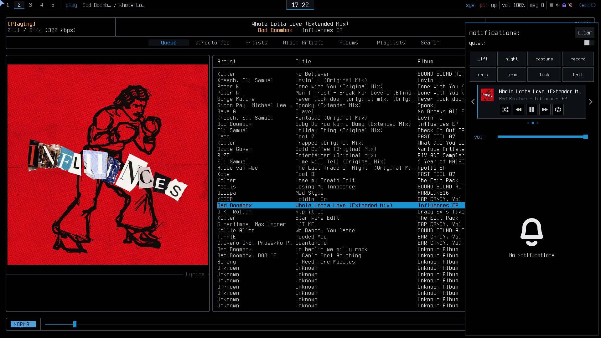

# dotfiles

My Arch + Hyprland desktop in Diag, the look of [sh0ds.dev](https://sh0ds.dev) in Arch Linux blue.


## Description

These are the configs I use every day. It runs Hyprland 0.56 with the new Lua config: `hyprland.lua` is a plain base config and `rice.lua` has the look, the window rules and my extra keybinds on top. If something in `rice.lua` breaks, the base still works.

### Look

My site looks like the screen a Raspberry Pi 5 shows before Linux boots, and I wanted the desktop to match it, just in Arch colours. So it's black, cool greys and Arch blue (`#1793d1`), one font everywhere (Terminess, Terminus with Nerd Font icons, readable at every size), and text written as `key: value` with the key in blue. Rules are 2 px, panels get the site's double rule, and anything that's on is an inverted blue block. Windows tile with small gaps, square corners and a 2 px border, and only the focused window gets a blue frame. No shadows, no blur, no transparency. Motion is small and physical. Anything that moves runs on a critically damped spring, the fastest a spring can settle without overshooting, and an interrupted move bends towards its new target instead of restarting. New windows grow in from 97 %, tiles glide aside, and workspaces shift 8 % under a cross-fade. Things that only appear or go away fade in 120 ms, and closing is about twice as fast as opening. The bar never moves. Firefox, Obsidian, the login screen and the boot splash get the same look. The lock screen is the site's header: a pixel Arch logo with `host:`, `kern:` and `up:` next to it.

Every app I use gets the same colours, GTK and Qt included, and Neovim has its own little `diag` scheme where code is grey, keywords are bright and strings and numbers are blue.


### Bar

One diagnostic line along the bottom under a double rule, no icons. Workspace numbers (the current one as a blue block) and `play:` with what's playing on the left, LIVE or REC in the middle while I'm sharing or recording. On the right `stats`: click it and `cpu:`, `mem:` and `temp:` show up in its place (hover for GPU and network detail), click again and it's back to `stats`, so nothing ticks away all day (right-click opens btop). After that `pi: up`, `vol: 64`, `msg:`, `time:` with an ISO date and `halt` for the power menu. Hovering only brightens the text. The main screen is DP-4, on the right of the desk: it gets workspaces 1 to 5, the cursor, the games and the login screen (`system/install-system.sh` switches the other screens off while SDDM runs).

### Quick apps

The things I need for a few seconds are normal tiled windows with one key each. The key starts the app next to what I'm doing, pressing it again hides it, and the next press brings it back tiled wherever I am now. Mail starts hidden at login, so its notifications work from the start.

- `SUPER+S` SoundCloud (a web app through [PWAsForFirefox](https://github.com/filips123/PWAsForFirefox)), `SUPER+U` my own music (rmpc)
- `SUPER+Y` Proton Calendar (also a web app, or click the clock)
- `SUPER+I` WhatsApp (in the terminal with [nchat](https://github.com/d99kris/nchat)), `SUPER+SHIFT+I` mail (in the terminal with [aerc](https://aerc-mail.org))
- `CTRL+SHIFT+Escape` btop, same key as the task manager on Windows


### What's in it

Desktop:

- **swaync** for notifications (`SUPER+N` opens the panel), **swayosd** for the volume bar, **fuzzel** as the launcher. fuzzel also runs the calculator, emoji picker, docs search, clipboard history, window switcher and Wi-Fi menu.
- **hyprlock** locks the screen: black, `user@host`, kernel and uptime, the clock, a `password:` prompt and whatever is playing. **hypridle** locks after 10 minutes, turns the screens off after 11 and suspends after an hour.
- **wlogout** is the power menu, **udiskie** mounts USB sticks when you plug them in (`SUPER+SHIFT+U` unmounts them all), and **awww** draws the background: black with a faint dot grid and a dim pixel Arch logo, 1:1 so it stays sharp.

Terminal:

- **kitty + tmux**, both in the same colours. kitty sends a notification when a long command finishes while I'm looking elsewhere. The tmux prefix is `Ctrl+A`.
- **bash** with [starship](https://starship.rs) as one plain line, eza instead of ls, fzf on `Ctrl+R` and zoxide (`z`). New terminals greet you with fastfetch.
- **Neovim** with LazyVim. My cheat sheet for it is in [docs/neovim.md](docs/neovim.md).
- **yazi** for files (`SUPER+E`, or `y` and the shell follows you to wherever you quit it), **lazygit** (`lg`), **bat** instead of cat and **tldr** instead of man pages for quick examples.


Apps:

- **mpd + rmpc** for my own music in `~/Music`. The bar, the media keys and the lock screen pick it up just like SoundCloud. PipeWire plays every song at its own sample rate and [Easy Effects](https://github.com/wwmm/easyeffects) corrects my Corsair Virtuoso XT to the Harman curve without clipping, setup in [docs/audio.md](docs/audio.md).
- **mpv, imv and zathura** for videos, pictures and PDFs. Opened from a terminal they take its place until you close them.
- **A Windows VM** for everything DJ: Lexicon, rekordbox, Traktor and Audacity. `SUPER+SHIFT+M` starts it on workspace 7, and songs I drop into `~/Music/DJ` show up in Windows as drive `Z:`. Setup in [docs/dj-vm.md](docs/dj-vm.md).
- **aerc** for mail: my Proton address (through Proton Mail Bridge) and my two sh0ds.dev addresses, one tab each. New mail shows up as a notification, HTML mails show as text with images and trackers blocked, and replies are written in Neovim.
- **Obsidian** for notes on `SUPER+O`, **Proton Pass** for passwords on `SUPER+SHIFT+P`.
- **Steam** and every game go on workspace 5. Games get GameMode on their own, adaptive sync, no vsync for lower input lag, and quiet notifications until you quit.

Keeping Arch healthy:

- A notification shows up when 20 or more updates are waiting, with a button that runs the update (AUR included). It tells you when one needs a reboot too.
- snapper takes a snapshot before and after every update, so a broken one can be rolled back. Weekly timers clear out old packages, trim the SSD and refresh the mirror list.

### Scripts

Small scripts in `.local/bin` for things I kept needing. Each one has a short comment at the top.

- `app`: the start, hide and bring back logic behind `chat`, `inbox`, `calendar`, `music`, `sysmon`, `notes` and SoundCloud
- `wifi`: pick a Wi-Fi network in fuzzel (it asks for the password on new ones), right-click `wifi` in the bar for nmtui
- `winswitch`: ALT+Tab through all windows, most recent first
- `calc`: calculator, try `2^10`, `15% of 89` or `300 EUR to USD`
- `emoji`: the emoji you pick gets typed and copied
- `docs`: `h` for Hoogle, `p` for Hackage, `w` for the Arch Wiki, `m` for man pages, anything else goes to DuckDuckGo
- `site-dev`: my tmux session for working on sh0ds.dev, with windows for the editor, builds, a REPL and the Pi. The Pharo IDE (`~/pharo`, for the site's `site` command) is "Pharo" in the launcher
- `ocr`: drag a box around any text on screen and it's copied to your clipboard
- `rec-toggle`: record a part of the screen to `~/Videos`
- `share-picker`: a faster screen-share picker, since the default one kept freezing with Discord
- `live-status`: do-not-disturb while I share my screen, so nothing private pops up on stream
- `chat-notify`: WhatsApp messages as notifications, click one and it jumps to WhatsApp
- `inbox`: shows or hides aerc
- `keys`: every keybind from the table below in a searchable list (`SUPER+F1`)
- `app`: jumps to an app if it's open, otherwise starts it
- `notes`: Obsidian on `~/notes`, started or jumped to (`SUPER+O`)
- `dl`: downloads into `~/Downloads` with aria2, 16 connections at once, and pings you when it's done. `dl` on its own takes the link from the clipboard
- `aria2-rpc`: aria2 in the background so Firefox downloads go through it too, `dl-done` is its notification
- `djvm`: starts the Windows DJ VM and shows it, `djvm off` shuts it down
- `power-menu`: a keyboard-labelled power grid that adapts to HiDPI and portrait screens
- `power`: what the power menu's log out, reboot and shut down buttons run; it shuts the DJ VM down first
- `update-check`, `default-apps`, `nightlight`, and the helpers behind the bar and the lock screen (`bar-stats`, `pi-status`, `rec-status`, `np-title`)

## Screenshots

These screenshots show an older desktop revision. See [the Diag design review](docs/diag-design.md) for the current styling, validation and application notes.

The launcher with the calculator:


The notification panel:



The power menu and the lock screen:


## Getting Started

### Dependencies

Arch with Hyprland 0.56 or newer (the Lua config doesn't work on older versions) and the multilib repo turned on for Steam. Then these packages:

```
sudo pacman -S --needed hyprland hyprlock hypridle hyprsunset hyprpicker xdg-desktop-portal-hyprland \
  xdg-desktop-portal-gtk hyprpolkitagent waybar swaync swayosd awww fuzzel kitty tmux neovim \
  starship eza fzf zoxide fastfetch sl ttf-terminus-nerd xorg-xrandr noto-fonts-emoji \
  grim slurp satty wl-clipboard cliphist wf-recorder wtype playerctl pavucontrol pipewire-alsa easyeffects lsp-plugins-lv2 jq socat \
  libqalculate tesseract tesseract-data-eng libnotify unicode-emoji udiskie \
  yazi fd ripgrep aria2 poppler ffmpeg 7zip imagemagick btop lazygit bat tealdeer \
  aerc w3m gnome-keyring libsecret protonmail-bridge mpd rmpc mpd-mpris mpv imv zathura zathura-pdf-mupdf obsidian firefox \
  qemu-desktop libvirt virt-install virt-viewer edk2-ovmf swtpm virtiofsd passt \
  ufw adw-gtk-theme qt6ct gamemode lib32-gamemode pacman-contrib reflector kdeconnect
yay -S wlogout nchat proton-pass-bin
```

### Installing

Clone the repo and run the install script. It symlinks everything into your home folder and moves your old files to `~/.dotfiles-backup/` first, so nothing gets lost.

```
git clone https://github.com/sh0ds/dotfiles.git ~/code/dotfiles
bash ~/code/dotfiles/install-dotfiles.sh
```

The installer renders the Qt palette path for your home directory and copies btop’s and nchat’s writable configurations; other theme files remain linked. Close btop and nchat before installing. See [the design review](docs/diag-design.md) for the isolated install and validation commands.

Then run these once. They set the default apps, let games use GameMode, turn on the weekly timers and the firewall (Arch doesn't come with one, so anything listening is open to the whole network), with the ports KDE Connect needs to find your phone:

```
default-apps
sudo usermod -aG gamemode $USER
sudo systemctl enable --now paccache.timer fstrim.timer reflector.timer
sudo ufw default deny incoming && sudo ufw enable && sudo systemctl enable ufw
sudo ufw allow 1714:1764/udp && sudo ufw allow 1714:1764/tcp
```

And change a few things to your liking:

- Replace `/home/sh0ds` with your own home folder in `hypr/xdph.conf` (the Qt palette path is generated by the installer).
- Set your country in `/etc/xdg/reflector/reflector.conf` (e.g. `--country Germany`) so it picks mirrors close to you.
- For SoundCloud, install it as an app with PWAsForFirefox and put your ID from `firefoxpwa profile list` in the `soundcloud` line in `rice.lua`.
- For the Diag look in Firefox (black toolbars, Terminess, the selected tab marked in blue, a plain black new tab), close Firefox and run `firefox-style` once. It links `~/.config/firefox` into your profile.
- For the login screen and boot splash in the same look, run `bash ~/code/dotfiles/system/install-system.sh` (it asks for sudo). Preview the login screen with `sddm-greeter-qt6 --test-mode --theme /usr/share/sddm/themes/diag`.
- For the calendar, open calendar.proton.me in Firefox and install it as an app the same way. Put its ID from `firefoxpwa profile list` in the `id=` line of `~/.local/bin/calendar`, then reload Hyprland. In Proton Calendar's settings, the Carbon theme fits best.
- For WhatsApp, run `nchat --setup` once, pick WhatsApp and scan the QR code with your phone. For notifications, quit nchat and run:

  ```
  f=~/.config/nchat/ui.conf
  sed -i '/^desktop_notify_\(enabled\|connectivity\|command\)=/d' "$f"
  printf '%s\n' 'desktop_notify_enabled=1' 'desktop_notify_connectivity=0' "desktop_notify_command=chat-notify '%1' '%2'" >> "$f"
  ```
- For music, put your files in `~/Music` and start mpd. It picks up new files on its own after that:

  ```
  mkdir -p ~/Music ~/.local/share/mpd/playlists
  systemctl --user enable --now mpd.service mpd-mpris.service
  ```
- For snapshots, check that `/` is btrfs (`findmnt -no FSTYPE /` says `btrfs`), then:

  ```
  sudo pacman -S snapper snap-pac
  sudo snapper -c root create-config /
  sudo snapper -c root set-config TIMELINE_CREATE=no NUMBER_LIMIT=10
  sudo systemctl enable --now snapper-cleanup.timer
  ```

  If `create-config` says `.snapshots` already exists (archinstall makes one), run `sudo umount /.snapshots && sudo rmdir /.snapshots` before it and `sudo btrfs subvolume delete /.snapshots && sudo mkdir /.snapshots && sudo mount -a` after it. `sudo snapper list` shows your snapshots and `sudo snapper undochange 41..42` undoes everything between two of them. On ext4 use `yay -S timeshift-autosnap` instead.
- For notes, press `SUPER+O` once and pick "Open folder as vault" with `~/notes` (your old `inbox.md` is already in there). For the look, pick the dark base theme under Settings > Appearance and turn on the `diag` CSS snippet there (`notes` links it in).
- For Firefox downloads through aria2, get the [Aria2 Integration](https://addons.mozilla.org/firefox/addon/aria2-extension/) add-on. In its settings add a server with host `localhost`, port `6800`, path `/jsonrpc`, no SSL, and the secret from `aria2-rpc secret | wl-copy`. Then turn on "Capture downloads". Downloads that need you logged in might fail through aria2; add that site to the add-on's excluded sites and Firefox downloads it itself.
- In Proton Pass, turn on "Start at login" if you want it in the tray, and get its Firefox add-on for filling in passwords.
- For the DJ VM (Lexicon, rekordbox, Traktor, Audacity), follow [docs/dj-vm.md](docs/dj-vm.md). It takes about an hour, mostly Windows installing itself.
- For mail, aerc gets its passwords from the keyring, so start that once with `systemctl --user enable --now gnome-keyring-daemon.socket` (SDDM unlocks it when you log in, as long as the keyring password is your login password; after a tty login it stays locked until something asks for it). Proton needs a paid plan for Bridge (`protonmail-bridge` in the package list above).

  Log in to Bridge (`protonmail-bridge`), then in its settings set the IMAP and SMTP connection mode to SSL. Click your account to see the Bridge password (it isn't your Proton password). Then save the three passwords, each command asks for one:

  ```
  secret-tool store --label="mail: proton" aerc proton
  secret-tool store --label="mail: mail@sh0ds.dev" aerc sh0ds-mail
  secret-tool store --label="mail: security@sh0ds.dev" aerc sh0ds-security
  ```

  The IONOS folder names in `accounts.conf` are the German ones. If sending says it can't save to "Gesendete Objekte", open the folder list in aerc and change `copy-to` to what your Sent folder is called.
- The keyboard is German with Caps Lock as Escape. Change `kb_layout` in `hyprland.lua` for yours.
- Not on NVIDIA? Delete the two NVIDIA lines in `hyprland.lua`.
- The `pi up` reading and `pi-status` are for my Raspberry Pi. Delete them, or set `PI_HOST` in `pi-status` to your own. `site-dev` expects a repo in `~/code/website` (or set `SITE_REPO`) and a `pi` host in `~/.ssh/config`.

### Executing program

Log out and back into Hyprland (duh). To see if anything is missing, run this. It lists everything with OK or FAIL:

```
bash ~/code/dotfiles/check-desktop.sh
```

### Keybinds

| Key | What it does |
| --- | --- |
| `SUPER+F1` | This list, searchable |
| `SUPER+Return` | Terminal |
| `SUPER+Space` | Launcher |
| `SUPER+B` | Firefox |
| `SUPER+E` | Files |
| `SUPER+O` | Notes (Obsidian, opens or jumps to it) |
| `SUPER+S` / `SUPER+U` | SoundCloud / music player |
| `SUPER+Y` | Calendar |
| `SUPER+I` / `SUPER+SHIFT+I` | WhatsApp / mail |
| `CTRL+SHIFT+Escape` | btop |
| `SUPER+SHIFT+M` | Windows DJ VM |
| `SUPER+SHIFT+P` | Proton Pass |
| `SUPER+A` | My tmux session for the site |
| `ALT+Tab` | Switch windows |
| `SUPER+C` | Calculator |
| `SUPER+.` | Emoji picker |
| `SUPER+D` | Search docs |
| `SUPER+SHIFT+V` | Clipboard history |
| `SUPER+SHIFT+T` | Copy text from the screen |
| `SUPER+SHIFT+C` | Colour picker |
| `Print` or `SUPER+SHIFT+S` / `SHIFT+Print` | Screenshot a region to the clipboard / the screen you're on to `~/Pictures` |
| `CTRL+Print` | Screenshot and draw on it |
| `SUPER+SHIFT+R` | Start or stop recording |
| `SUPER+N` | Notifications |
| `SUPER+SHIFT+N` | Night light |
| `SUPER+SHIFT+B` | Hide or show the bar |
| `SUPER+SHIFT+U` | Unmount USB sticks |
| `SUPER+Q` | Close window |
| `SUPER+F` / `SUPER+M` | Fullscreen / maximise |
| `SUPER+V` / `SUPER+X` | Float and center / center again |
| `SUPER+T` | Flip the split between two windows |
| `SUPER+G` / `SUPER+Tab` | Group windows into tabs / next tab |
| `SUPER+Escape` | Lock |
| `SUPER+SHIFT+Escape` | Power menu (lock, log out, suspend, reboot, shut down) |

Moving around works with `SUPER` + arrow keys or `h j k l`, add `SHIFT` to move the window and `CTRL` to resize it. `SUPER+1-0` switches workspace, `SUPER+SHIFT+1-0` sends the window there. The media and volume keys work too, even on the lock screen.

## Help

This is set up for my machine (NVIDIA, two 1080p monitors), so some things might need changing on yours.

- A keybind for one of the scripts does nothing? Run the install script again, new scripts only get linked into `~/.local/bin` when it runs.
- `q` in rmpc quits it instead of hiding it, use `SUPER+U` to hide it. If it ever won't come down, `pkill -x rmpc` and press `SUPER+U` again.
- WhatsApp notifications don't show up? Make sure nchat was closed when you edited `ui.conf`, it overwrites the file when it quits.
- KDE Connect can't find your phone? The firewall blocks it, let it through with `sudo ufw allow 1714:1764/udp && sudo ufw allow 1714:1764/tcp`.
- Steam Remote Play or downloads from another PC on the network can't find this one? The firewall blocks them, allow Steam's ports with `sudo ufw allow 27031:27036/udp && sudo ufw allow 27036:27037/tcp`.
- A GTK app is still light? Log out and back in once, the dark mode gets set at login.
- The screen-share picker doesn't show up? Restart the portal:

  ```
  systemctl --user restart xdg-desktop-portal-hyprland
  ```

## Credits

The Diag look is mine (from my site), but the swaync, btop, lazygit, rmpc, aerc, zathura, qt6ct and [yazi](https://github.com/yazi-rs/flavors) theme files started as [Catppuccin](https://github.com/catppuccin)'s ports and were recoloured. The Neovim base is [LazyVim](https://github.com/LazyVim/LazyVim).

## License

This project is licensed under the MIT License - see the LICENSE file for details
